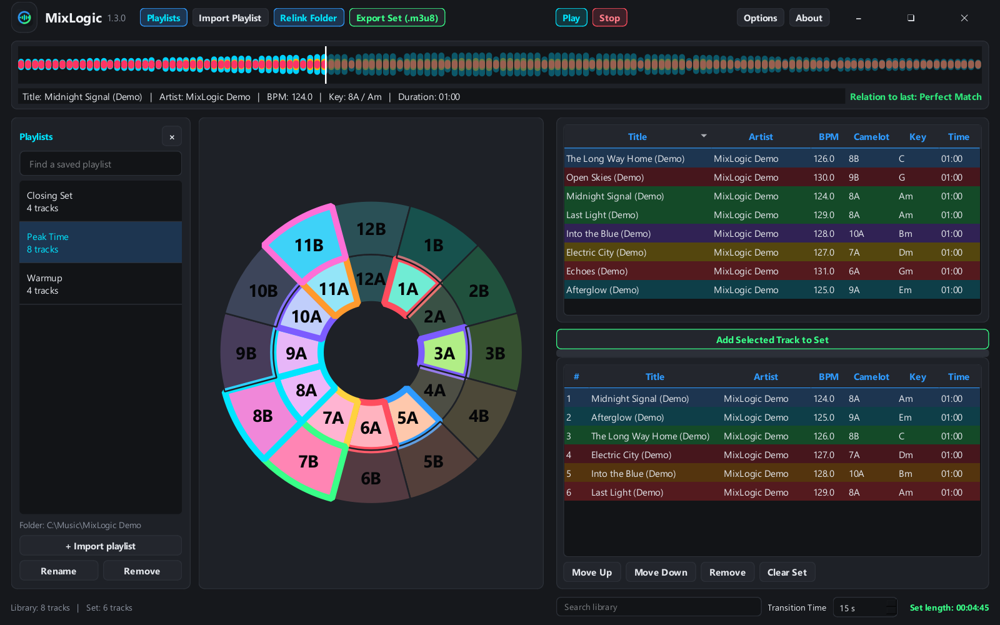
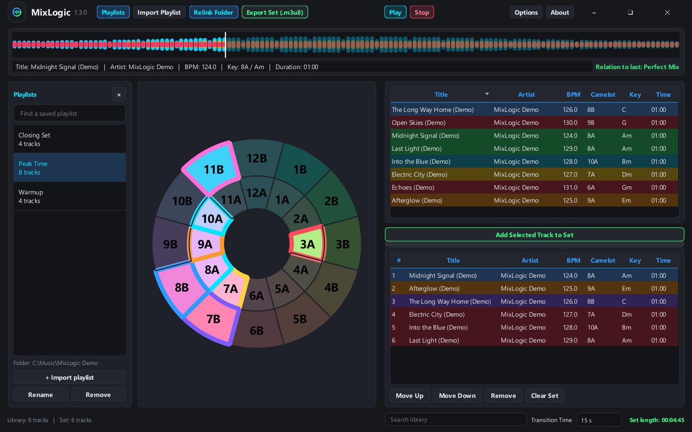
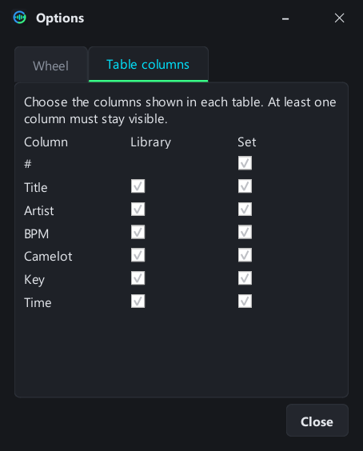

<p align="center"></p>
<h1 align="center">MixLogic</h1>
<p align="center"><strong>Build your next Rekordbox set with a clearer view of what comes next.</strong></p>
<p align="center">Harmonic mixing · Saved playlists · Track previews · Exact playlist order</p>

MixLogic is a Windows DJ set builder for Rekordbox playlists. Import your M3U8 and TXT exports, explore key relationships on a large Camelot wheel, audition tracks, arrange your set, and export the finished order back to Rekordbox.

**Version 1.3.0** · **Windows x64** · **GPL-3.0-or-later** · Created by **snuffy420 / zerØ software**

## Download and run

Choose the package that matches how you want to use MixLogic:

| Package | Contents | Requirements |
| --- | --- | --- |
| `MixLogic-1.3.0-windows-x64-portable.7z` | A nested `MixLogic/` folder containing `MixLogic.exe`, documentation and license notices | Windows 10/11 x64; no Python installation |
| `MixLogic-1.3.0-source.7z` | Application source, pinned dependencies, tests, assets, screenshot and release tools | Python 3.12; see [Building from source](docs/BUILDING.md) |

1. Extract the **entire portable archive** into a folder you can write to.
2. Open the extracted **MixLogic** folder and run **MixLogic.exe**.
3. Import your first playlist. Saved data and the waveform cache will be created inside this folder as you use the app.

Do not run the executable from inside the archive. The portable build is unsigned, so Windows may show an unknown-publisher prompt. No installer, administrator privileges or separate FFmpeg installation is normally needed.

## Main workspace



*Screenshots use generated demo audio and example metadata, not a bundled music library.*

- **Playlists** shows or hides your saved playlist browser.
- **Import Playlist** opens a Rekordbox M3U8/TXT pair, or reopens a set exported by MixLogic.
- **Relink Folder** locates your music and remembers the folder for that playlist. Its active highlight indicates a configured folder.
- **Play / Stop** preview the selected track. Play changes to Pause during playback.
- **Export Set (.m3u8)** saves the lower table in its exact playing order.
- **Options** controls the wheel, relation chart, highlighting and visible columns.
- **Search library**, beneath the right panel, filters the imported tracks without changing the set order.
- **Transition Time** estimates overlap between tracks when calculating the total set length.

The compact header is draggable and includes minimize, maximize/restore and close controls. The larger app logo and name appear once.

## Start with a Rekordbox playlist

1. In Rekordbox, export the playlist as **M3U8** and as a **TXT** file. Use the same playlist for both exports.
2. In MixLogic, select **Import Playlist**, choose the M3U8, then choose its matching TXT export.
3. If the audio has moved, select **Relink Folder** and choose the folder containing it. Subfolders are searched too.
4. Select a track in the library to update the wheel, waveform, details and relation to the last track in your set.
5. Select **Add Selected Track to Set** to append it to the lower table.
6. Use **Move Up**, **Move Down**, **Remove** and **Clear Set** to arrange your playing order.
7. Choose **Export Set (.m3u8)** when you are ready.
8. In Rekordbox, choose **File → Import → Import Playlist** and select the exported M3U8. Export to your DJ player or USB from Rekordbox as usual.

Rekordbox documents M3U8 playlist import in its [official manual](https://cdn.rekordbox.com/files/20260409151936/rekordbox7.214_manual_EN.pdf), under “Importing a playlist file”.

The exported file contains references to your audio files, not copies of the music. Keep the files at those locations or relink before exporting. MixLogic checks for missing audio before writing the playlist.

## Saved playlists and session restore

Import each Rekordbox TXT/M3U8 pair once. **Playlists** lets you search your saved imports, switch between libraries, rename entries and remove entries from the browser.

Each saved playlist keeps:

- Copies of the original M3U8 and TXT exports.
- Parsed titles, artists, BPM, keys, durations and resolved audio paths.
- Its own linked music folder.

Reimporting the same file pair updates the saved entry and keeps its chosen name and music folder. Renaming an entry does not rename your source exports. Removing an entry keeps the saved source copies and your audio files.

Switching libraries keeps the set you are building intact, so you can combine tracks from multiple playlists. Reopening MixLogic restores the last library, selected preview track, current set and preferences. Playback does not start automatically.

## The Camelot wheel and two relation charts

Select a track in **either** table to make its key the wheel's reference. Selecting a set track also leaves it available for reordering or removal. The library highlights possible choices against the previewed track; the set's row colours describe transitions between its own neighbours.

In **Options → Wheel**, choose Camelot numbers, musical key names, or both, and switch between the two supplied relation charts:

| Chart | Relation groups |
| --- | --- |
| **Chart 1 — energy boost / drop** | Perfect Match, Energy Boost +/++/+++, Energy Drop -/--/---, Mood Change |
| **Chart 2 — harmonic transitions** | Perfect Mix, -1 Mix, +1 Mix, Energy Boost, Scale Change, Diagonal Mix, Jaw's Mix, Mood Shifter |




Relations are directional: a transition from one key to another can have a different label when reversed. The **Relation to last** label compares the previewed track with the last track currently in the set and updates when the chart or set changes.

### Colours and highlighting

In the default table mode, **green** marks perfect matches and selected boosts, **orange** marks other listed transitions, and **red** marks an unlisted/incompatible relation. The selected row uses the selection colour.

On the wheel, the selected key has a **cyan outline**. Keys outside the active chart's listed relationships are **dimmed**. Turn on **Show all variations** to give individual relation types their own colours; consult the full colour key in **About → Help**. In that mode a red relation colour can represent an energy drop, so it is different from the default table legend.

The charts are planning references. Track phrasing, arrangement, energy, vocals and what you hear still matter.

## Make the tables fit your workflow

Drag a column boundary to resize any column, including **Title** and **Artist**. Drag the horizontal divider between the library and set to change their heights. These choices are remembered.

Use **Options → Table columns** to independently show or hide columns in each table. At least one column must remain visible. Hiding a column does not delete its metadata or affect export order.



Close the playlist browser when you want more space for the wheel. Reopen it with the same **Playlists** button.

## Waveform preview and transition time

Selecting a track loads its waveform in the full-width strip. Waveform analysis runs in the background and is cached for subsequent use. Click or drag within the waveform to move the playback position. **Play** toggles playback/pause; **Stop** returns to the beginning.

Audio support depends on the actual codec and Qt Multimedia backend. Relinking searches WAV, MP3, FLAC, M4A, AIFF and AIF files. A supported extension alone does not guarantee that a particular file will decode.

**Transition Time** subtracts the chosen overlap from each join in the set:

`Estimated set length = sum of track durations − transition overlap × (track count − 1)`

This is a planning estimate. MixLogic exports a playlist; it does not render a continuous audio mix, add crossfades to the music, or write transition settings into Rekordbox.

## Export and reopen a finished set

The exported M3U8 keeps the lower table's **exact order**, including repeated tracks. Sorting or filtering the upper library does not change it.

MixLogic 1.3.0 exports also include optional metadata comment lines. They let the file reopen in MixLogic with its titles, artists, BPM, keys, times and order intact, without a separate TXT file. Use **Import Playlist** and select the exported M3U8; it loads the ordered set for editing. If a set is already open, MixLogic asks before replacing it.

Normal playlist entries remain standard `#EXTM3U` / `#EXTINF` entries with absolute audio paths. Audio files and embedded music tags are not modified. In Rekordbox, display the playlist's normal track order if another column sort is active.

### UTF-16 versus UTF-8

Rekordbox's **TXT export** uses UTF-16. **M3U8 playlists** use UTF-8. MixLogic reads UTF-16 and UTF-8 text exports and writes M3U8 in UTF-8. Changing the M3U8 to UTF-16 is not required. See the [official explanation of Rekordbox TXT encoding](https://forums.pioneerdj.com/hc/en-us/community/posts/4410847416729-bug-report-export-playlist-to-a-file-has-extraneous-unprintable-characters).

## Portable data, backups and updates

The portable archive extracts to one folder:

```text
MixLogic/
├── MixLogic.exe
├── README.md
├── CHANGELOG.md
├── LICENSE
├── THIRD_PARTY_NOTICES.md
├── docs/
├── assets/
└── licenses/
```

The app creates these **after you launch and use it**:

```text
MixLogic/
├── MixLogic-data/
│   ├── library.sqlite3       # Saved playlists, preferences and current session
│   └── sources/              # Copies of imported TXT/M3U8 files
└── waveform_cache.db         # Reusable waveform analysis
```

Back up the entire **MixLogic-data** folder while the app is closed. To update, close the current copy and replace the executable with the new one, keeping that folder. To move the portable application, move the whole MixLogic folder together. Your music is not inside it unless you put it there yourself; moving the app does not relocate your audio.

The public packages contain no saved personal libraries, generated settings, cache database or music files. Saved application data stays local. User-triggered GitHub/help links can open a browser; there is no account login or cloud playlist sync.

## Troubleshooting and current limits

| Symptom | What to check |
| --- | --- |
| Import shows unexpected BPM or keys | Use the matching Rekordbox TXT export and review its data. Missing metadata currently falls back to 120 BPM / 8A, so verify incomplete imports against Rekordbox. |
| Relink finds only some tracks | Select a parent folder that contains the audio. Matching is name-based; review results where different files share a filename. |
| Export reports missing audio | Relink the saved playlist or reconnect the relevant drive. Cached metadata does not replace the audio file. |
| A preview will not play | Confirm the file exists and uses a supported encoding. Try a known-good WAV to distinguish path problems from codec problems. |
| The library columns disappear off the right edge | Resize/hide unused columns, or scroll horizontally. Column widths remain as you chose them. |
| A wheel relation looks different after changing charts | Each chart has its own directional mapping and labels. Check the active chart and the Help colour key. |
| An older generic M3U8 does not restore BPM/key | Automatic metadata round-trip applies to MixLogic 1.3.0 exports. A Rekordbox or older generic playlist still needs its matching TXT metadata. |
| Preferences do not save | Extract the entire portable folder to a writable location. Avoid running inside an archive or a protected program directory. |

Automated checks cover playlist ordering, metadata round-trip, saved folders, UI state and chart mappings. A live import in the Rekordbox desktop application is a separate manual compatibility check; see [Validation](docs/VALIDATION.md).

## Run from source

Use Python **3.12** on Windows x64:

```powershell
python -m venv .venv
.\.venv\Scripts\python.exe -m pip install -r requirements.txt
.\.venv\Scripts\python.exe main.py
```

Alternatively, run **setup.ps1**, then **Run MixLogic.cmd**. From source, generated data is stored beside `main.py`.

For tests, builds, screenshot capture and release packaging, see [Building from source](docs/BUILDING.md). The release tools prepare local artifacts and a clean GitHub folder; they do not create a remote repository or publish a release.

## Changelog, source and licensing

See the full [1.3.0 changelog](CHANGELOG.md) and [release notes](docs/RELEASE_NOTES_1.3.0.md).

MixLogic application code and original graphics are **GPL-3.0-or-later**. See [LICENSE](LICENSE), [COPYRIGHT](COPYRIGHT), [third-party notices](THIRD_PARTY_NOTICES.md) and [publishing notes](docs/PUBLISHING.md). Third-party components retain their own licenses.

## Support and credits

**zerØ software** · © 2026 · Created by [snuffy420](https://github.com/snuffy420).

If MixLogic is useful to you, optional Bitcoin donations support its development:

`bc1qz8877p6vusc22qrctdj4h7w0uk2l9l9h8lwphy`

Use **About → Donate → Copy BTC address**, or scan the in-app QR code. The copy confirmation uses a reserved footer and does not resize the window.

MixLogic is an independent project, not an official Rekordbox or AlphaTheta product. Product names belong to their respective owners.
