<p align="center"></p>
<h1 align="center">MixLogic</h1>
<p align="center"><strong>Build your next Rekordbox set with a clearer view of what comes next.</strong></p>
<p align="center">Harmonic mixing · Saved playlists · Track previews · Exact playlist order</p>

MixLogic is a DJ set builder for Rekordbox playlists. Import your M3U8 and TXT exports, explore key relationships on a large Camelot wheel, audition tracks, arrange your set, and export the finished order back to Rekordbox. Ready-to-run releases target Windows x64; macOS and Linux users can run the Python source.

<p align="center">
<a href="https://github.com/snuffy420/MixLogic/releases/tag/v1.4.0">Download 1.4.0</a> ·
<a href="#macos-source-setup">macOS setup</a> · <a href="#linux-source-setup">Linux setup</a> ·
<a href="https://snuffy420.github.io/MixLogic/docs/contact.html">Contact</a>
</p>

**Version 1.4.0** · **Windows x64** · **GPL-3.0-or-later** · Created by **snuffy420 / zerØ software**

## Download and run

Choose the package that matches how you want to use MixLogic:

| Package | Contents | Requirements |
| --- | --- | --- |
| [Windows x64 installer](https://github.com/snuffy420/MixLogic/releases/download/v1.4.0/MixLogic-1.4.0-windows-x64-setup.exe) | Themed installer, complete app, uninstaller, Start Menu entries and optional desktop shortcut | Windows 10/11 x64; administrator access for the default Program Files installation |
| [Windows x64 portable](https://github.com/snuffy420/MixLogic/releases/download/v1.4.0/MixLogic-1.4.0-windows-x64-portable.7z) | A nested `MixLogic/` folder containing `MixLogic.exe`, documentation and license notices | Windows 10/11 x64; no Python installation |
| [Source ZIP](https://github.com/snuffy420/MixLogic/releases/download/v1.4.0/MixLogic-1.4.0-source.zip) / [7z](https://github.com/snuffy420/MixLogic/releases/download/v1.4.0/MixLogic-1.4.0-source.7z) | Application source, pinned dependencies, tests, assets, screenshot and release tools | Python 3.12 recommended; [Windows, macOS and Linux instructions](docs/SOURCE_SETUP.md) |

For the installer, run **MixLogic-1.4.0-windows-x64-setup.exe** and follow the wizard. It installs to **Program Files\\MixLogic** by default. Select the desktop-shortcut checkbox if wanted. Remove it later through Windows **Settings → Apps → Installed apps** (or Add/Remove Programs). Your saved playlists and preferences remain in `%LOCALAPPDATA%\\MixLogic` after uninstalling.

For the portable version:

1. Extract the **entire portable archive** into a folder you can write to.
2. Open the extracted **MixLogic** folder and run **MixLogic.exe**.
3. Import your first playlist. Saved data and the waveform cache will be created inside this folder as you use the app.

Do not run the executable from inside the archive. The Windows builds are unsigned, so Windows may show an unknown-publisher prompt. The portable version needs no installation or administrator privileges. Neither Windows package normally needs a separate FFmpeg installation.

## Main workspace

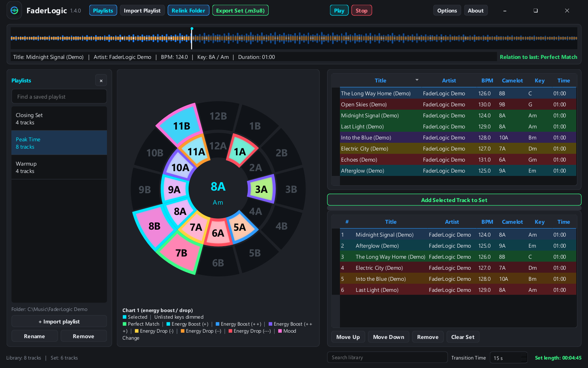

*Screenshots use generated demo audio and example metadata, not a bundled music library.*

- **Playlists** shows or hides your saved playlist browser.
- **Import Playlist** opens a Rekordbox M3U8/TXT pair, or reopens a set exported by MixLogic.
- **Relink Folder** locates your music and remembers the folder for that playlist. Its active highlight indicates a configured folder.
- **Play / Stop** preview the selected track. Play changes to Pause during playback.
- **Export Set (.m3u8)** saves the lower table in its exact playing order.
- **Options** controls the wheel, relation chart, highlighting and visible columns.
- **Search library**, beneath the right panel, filters the imported tracks without changing the set order.
- **Transition Time** estimates overlap between tracks when calculating the total set length.

The compact header is draggable and includes minimize, maximize/restore and close controls. The larger app logo and name appear once.

## Start with a Rekordbox playlist

1. In Rekordbox, export the playlist as **M3U8** and as a **TXT** file. Use the same playlist for both exports.
2. In MixLogic, select **Import Playlist**, choose the M3U8, then choose its matching TXT export.
3. If the audio has moved, select **Relink Folder** and choose the folder containing it. Subfolders are searched too.
4. Select a track in the library to update the wheel, waveform, details and relation to the last track in your set.
5. Select **Add Selected Track to Set** to append it to the lower table.
6. Use **Move Up**, **Move Down**, **Remove** and **Clear Set** to arrange your playing order.
7. Choose **Export Set (.m3u8)** when you are ready.
8. In Rekordbox, choose **File → Import → Import Playlist** and select the exported M3U8. Export to your DJ player or USB from Rekordbox as usual.

Rekordbox documents M3U8 playlist import in its [official manual](https://cdn.rekordbox.com/files/20260409151936/rekordbox7.214_manual_EN.pdf), under “Importing a playlist file”.

The exported file contains references to your audio files, not copies of the music. Keep the files at those locations or relink before exporting. MixLogic checks for missing audio before writing the playlist.

### Saved playlist browser

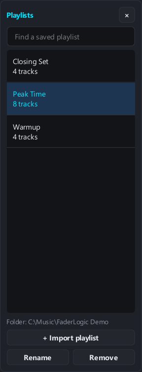

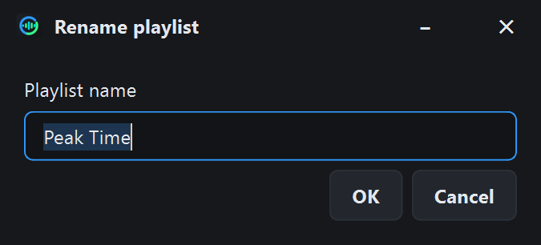

### Missing or unverified metadata

MixLogic uses the metadata in the matching exports; it does not analyse audio to determine a key or BPM. Missing, invalid or ambiguously matched fields display **Unknown** in both tables. The **!** row marker and field tooltips show what is missing; the compact **Metadata** button opens a bounded review table. It never substitutes a guessed key such as 8A or a guessed BPM such as 120. Tracks with an unknown key receive neutral compatibility colouring and no wheel highlights. If any set duration is unknown, its total length is shown as **Unknown**.

Correct incomplete metadata in Rekordbox and export/import a matching TXT/M3U8 pair again. Older saved imports are rechecked against their retained source files; values that cannot be recovered remain unknown. Valid source values of 8A or 120 BPM remain valid.

## Saved playlists and session restore

Import each Rekordbox TXT/M3U8 pair once. **Playlists** lets you search your saved imports, switch between libraries, rename entries and remove entries from the browser.

Each saved playlist keeps:

- Copies of the original M3U8 and TXT exports.
- Parsed titles, artists, BPM, keys, durations and resolved audio paths.
- Its own linked music folder.

Reimporting the same file pair updates the saved entry and keeps its chosen name and music folder. Renaming an entry does not rename your source exports. Removing an entry keeps the saved source copies and your audio files.

Switching libraries keeps the set you are building intact, so you can combine tracks from multiple playlists. Reopening MixLogic restores the last library, selected preview track, current set and preferences. Playback does not start automatically.

## The Camelot wheel and two relation charts

Select a track in **either** table to make its key the wheel's reference. Selecting a set track also leaves it available for reordering or removal. The library highlights possible choices against the previewed track; the set's row colours describe transitions between its own neighbours.

In **Options → Wheel**, choose Camelot numbers, musical key names, or both, and switch between the two supplied relation charts:

| Chart | Relation groups |
| --- | --- |
| **Chart 1 — energy boost / drop** | Perfect Match, Energy Boost +/++/+++, Energy Drop -/--/---, Mood Change |
| **Chart 2 — harmonic transitions** | Perfect Mix, -1 Mix, +1 Mix, Energy Boost, Scale Change, Diagonal Mix, Jaw's Mix, Mood Shifter |


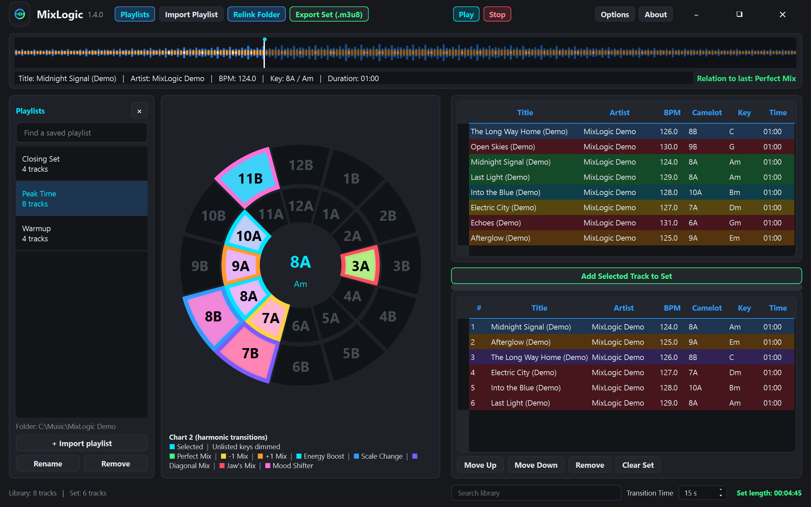

Relations are directional: a transition from one key to another can have a different label when reversed. The **Relation to last** label compares the previewed track with the last track currently in the set and updates when the chart or set changes.

### Colours and highlighting

In the default table mode, **green** marks perfect matches and selected boosts, **orange** marks other listed transitions, and **red** marks an unlisted/incompatible relation. The selected row uses the selection colour.

On the wheel, the selected key has a **cyan outline**. Keys outside the active chart's listed relationships are **dimmed**. Turn on **Show all variations** to give individual relation types their own colours; consult the full colour key in **About → Help**. In that mode a red relation colour can represent an energy drop, so it is different from the default table legend.

The charts are planning references. Track phrasing, arrangement, energy, vocals and what you hear still matter.

## Choose your look

**Options → Appearance** previews five wheels, nine waveforms, four waveform modes and Dark/Light themes. Select your combination and click **Apply**; MixLogic remembers it at startup. The original **Classic** wheel and bars remain available. There are no 3D designs or GPU view dependencies.

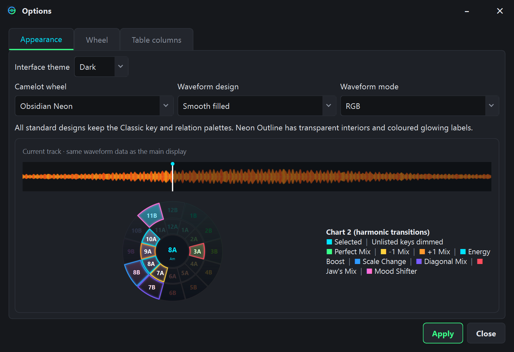

| Wheel | Look |
| --- | --- |
| Classic | Original filled wheel and familiar key colors |
| Obsidian Neon | Dark panels with glowing relation edges |
| Dark Minimal | Restrained fills and crisp highlights |
| Neon Outline | Transparent segment interiors with colored glowing outlines and labels |
| Colour-blind | Alternative relation palette, patterns and printed codes, plus a white double selected-key outline |

All standard designs use the same key and relation colors. Each wedge has its own isolated border/glow, so adjacent highlights retain their own colors. The selected key and musical name appear in the center of every wheel.

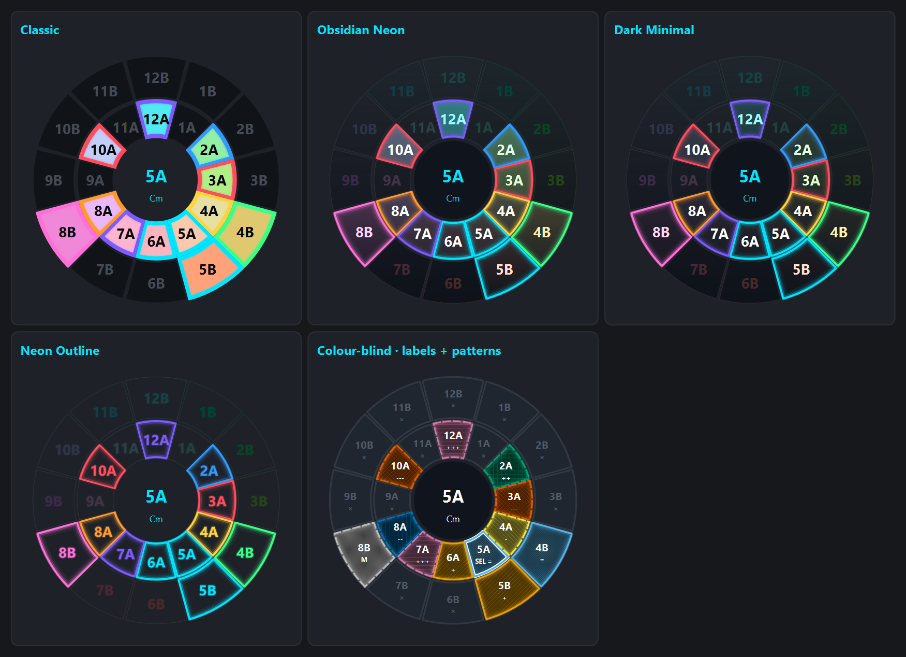

### Accessible colors and patterns

The Colour-blind wheel carries the relation through **color + pattern + text**, with a live legend for the active chart. Number, musical key and relation code have separate fitted rows in Both mode. **SEL =** means selected and a same-key perfect match: it keeps its blue relation color and adds a white double outline. **×** marks an unlisted/dimmed key. Each chart has its own correctly matched explanation in Help.

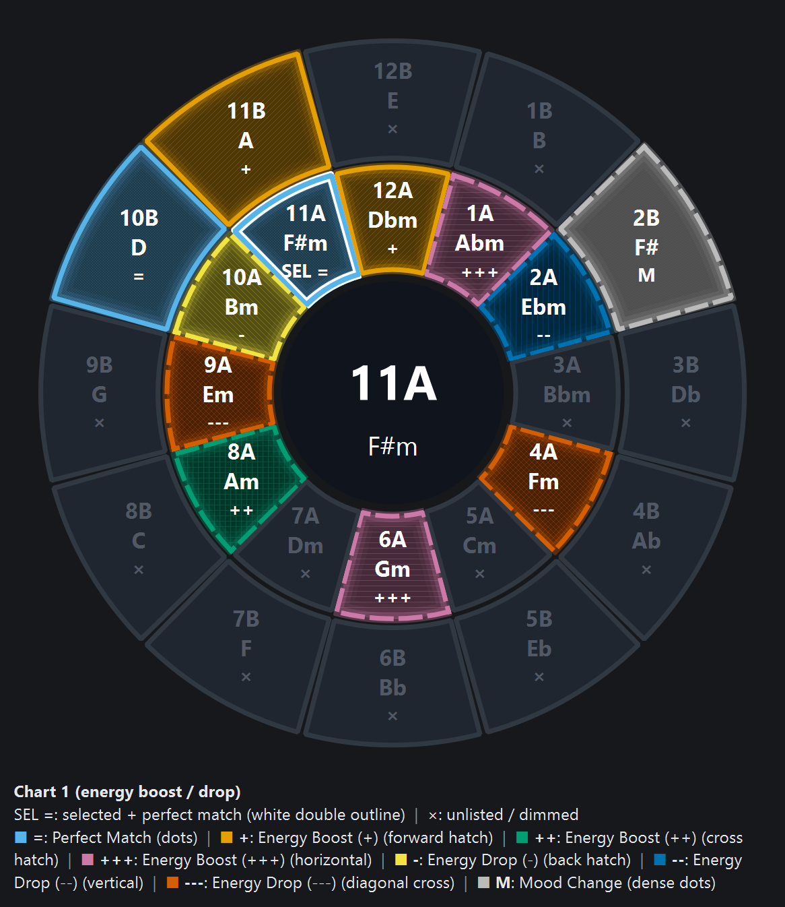

### Waveforms that match your tracks

Classic bars, Enhanced glow bars, Smooth filled, Spectrogram, Multilayer, Energy segments, Minimal glow line and two explicit Split bands designs are available. Each supports **Normal**, **RGB**, **3-band**, and **MixLogic · original colors**.

- Normal shows amplitude in cyan.
- RGB blends measured bass/red, mid/green and high/blue activity.
- 3-band overlays blue bass, orange mids and white highs on a shared waveform. It is MixLogic's own frequency representation, not proprietary Pioneer analysis.
- MixLogic retains the original cyan/orange/pink palette. Select it with Classic bars for the original display.
- Only **Split bands · bars** and **Split bands · ribbons** use three separate lanes.

The preview uses the loaded track's real waveform data and display height. Without a loaded track, it uses an original dance example processed with the same overview analyzer. Previews are cached; opening Options does not analyze or synthesize demo audio.

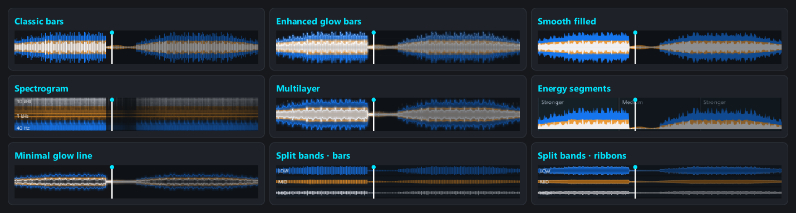

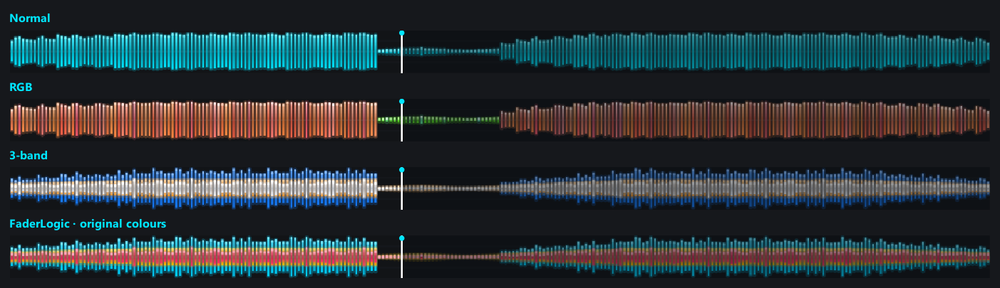

Energy segments indicate measured quieter/medium/stronger passages; they do not claim to detect intros, drops or breakdowns. The spectrogram shows measured frequency content. See the [appearance gallery and controls](docs/APPEARANCE.md) for more.

### Light theme

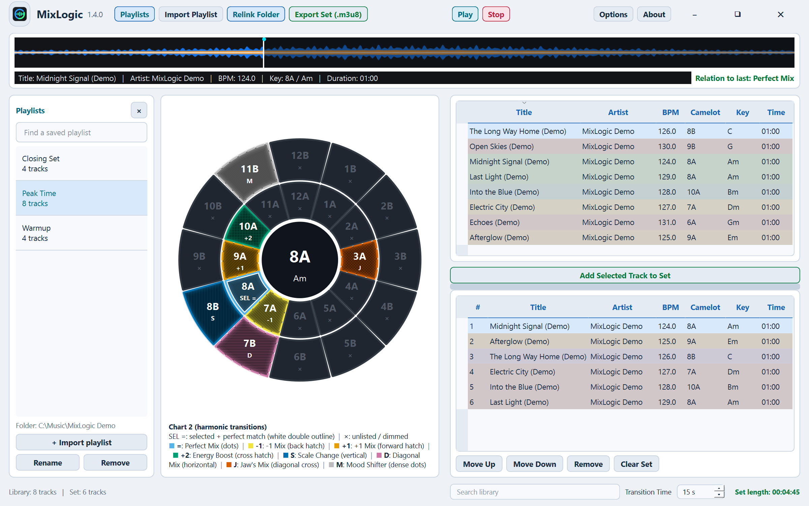

Theme changes preserve playlist order and the current preview. Musical/chart colors stay consistent; controls and table tints adapt for readability.

## Make the tables fit your workflow

Drag a column boundary to resize any column, including **Title** and **Artist**. Drag the horizontal divider between the library and set to change their heights. These choices are remembered.

Use **Options → Table columns** to independently show or hide columns in each table. At least one column must remain visible. Hiding a column does not delete its metadata or affect export order.

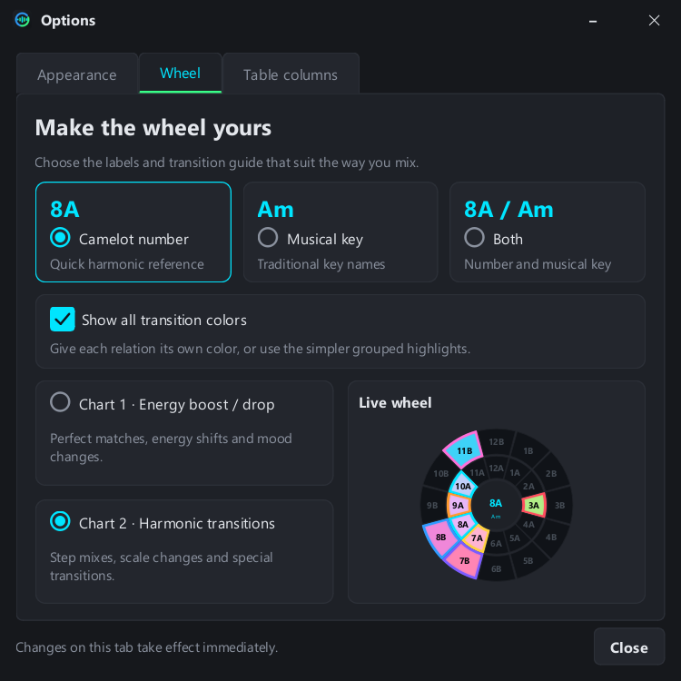

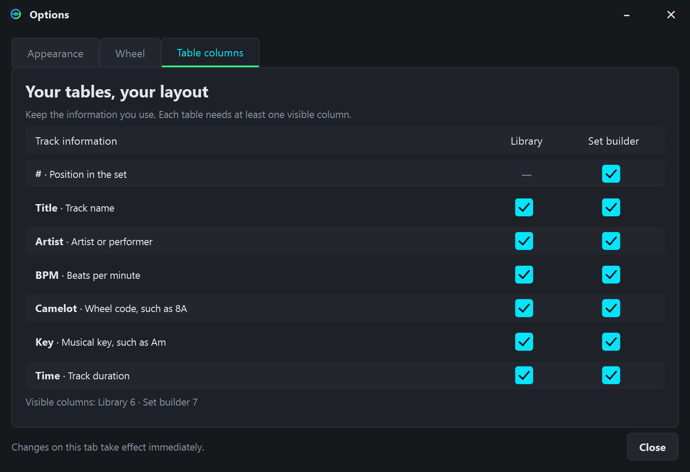

Close the playlist browser when you want more space for the wheel. Reopen it with the same **Playlists** button.

## Waveform preview and transition time

Selecting a track loads its waveform in the full-width strip. Waveform analysis runs in the background and is cached for subsequent use. Click or drag within the waveform to move the playback position. **Play** toggles playback/pause; **Stop** returns to the beginning.

Audio support depends on the actual codec and Qt Multimedia backend. Relinking searches WAV, MP3, FLAC, M4A, AIFF and AIF files. A supported extension alone does not guarantee that a particular file will decode.

**Transition Time** subtracts the chosen overlap from each join in the set:

`Estimated set length = sum of track durations − transition overlap × (track count − 1)`

This is a planning estimate. MixLogic exports a playlist; it does not render a continuous audio mix, add crossfades to the music, or write transition settings into Rekordbox.

## Export and reopen a finished set

The exported M3U8 keeps the lower table's **exact order**, including repeated tracks. Sorting or filtering the upper library does not change it.

MixLogic 1.4.0 exports also include optional metadata comment lines. They let the file reopen in MixLogic with its titles, artists, BPM, keys, times and order intact, without a separate TXT file. Use **Import Playlist** and select the exported M3U8; it loads the ordered set for editing. If a set is already open, MixLogic asks before replacing it.

Normal playlist entries remain standard `#EXTM3U` / `#EXTINF` entries with absolute audio paths. Audio files and embedded music tags are not modified. In Rekordbox, display the playlist's normal track order if another column sort is active.

### UTF-16 versus UTF-8

Rekordbox's **TXT export** uses UTF-16. **M3U8 playlists** use UTF-8. MixLogic reads UTF-16 and UTF-8 text exports and writes M3U8 in UTF-8. Changing the M3U8 to UTF-16 is not required. See the [official explanation of Rekordbox TXT encoding](https://forums.pioneerdj.com/hc/en-us/community/posts/4410847416729-bug-report-export-playlist-to-a-file-has-extraneous-unprintable-characters).

## Portable data, backups and updates

The portable archive extracts to one folder:

```text
MixLogic/
├── MixLogic.exe
├── README.md
├── CHANGELOG.md
├── LICENSE
├── THIRD_PARTY_NOTICES.md
├── docs/
├── assets/
└── licenses/
```

The app creates these **after you launch and use it**:

```text
MixLogic/
├── MixLogic-data/
│   ├── library.sqlite3       # Saved playlists, preferences and current session
│   └── sources/              # Copies of imported TXT/M3U8 files
└── waveform_cache.db         # Reusable waveform analysis
```

Back up the entire **MixLogic-data** folder while the app is closed. To update, close the current copy and replace the executable with the new one, keeping that folder. To move the portable application, move the whole MixLogic folder together. Your music is not inside it unless you put it there yourself; moving the app does not relocate your audio.

The public packages contain no saved personal libraries, generated settings, cache database or music files. Saved application data stays local. User-triggered GitHub/help links can open a browser; there is no account login or cloud playlist sync.

## Troubleshooting and current limits

| Symptom | What to check |
| --- | --- |
| Import reports unknown BPM, keys or time | Use the matching Rekordbox TXT export and review its declared metadata fields. MixLogic shows Unknown cells and ! row markers for unavailable metadata; it does not guess values. |
| Relink finds only some tracks | Select a parent folder that contains the audio. Matching is name-based; review results where different files share a filename. |
| Export reports missing audio | Relink the saved playlist or reconnect the relevant drive. Cached metadata does not replace the audio file. |
| A preview will not play | Confirm the file exists and uses a supported encoding. Try a known-good WAV to distinguish path problems from codec problems. |
| The library columns disappear off the right edge | Resize/hide unused columns, or scroll horizontally. Column widths remain as you chose them. |
| A wheel relation looks different after changing charts | Each chart has its own directional mapping and labels. Check the active chart and the Help colour key. |
| An older generic M3U8 does not restore BPM/key | Automatic metadata round-trip applies to sets exported by MixLogic. A Rekordbox or older generic playlist still needs its matching TXT metadata. |
| Preferences do not save | Extract the entire portable folder to a writable location. Avoid running inside an archive or a protected program directory. |

Automated checks cover playlist ordering, metadata round-trip, saved folders, UI state and chart mappings. A live import in the Rekordbox desktop application is a separate manual compatibility check; see [Validation](docs/VALIDATION.md).

## Run from source

Use Python **3.12** on Windows x64:

```powershell
python -m venv .venv
.\.venv\Scripts\python.exe -m pip install -r requirements.txt
.\.venv\Scripts\python.exe main.py
```

Alternatively, run **setup.ps1**, then **Run MixLogic.cmd**. From source, generated data is stored beside `main.py`.

### macOS source setup

The source runs through native Python and Qt. **macOS GUI/audio operation has not been tested on this release machine.** Use the source download, not the Windows EXE.

1. Download the source archive from [Releases](https://github.com/snuffy420/MixLogic/releases/tag/v1.4.0), or choose **Code → Download ZIP** on GitHub and extract the whole folder.
2. Install **Python 3.12 or 3.13** from [python.org](https://www.python.org/downloads/macos/). Run its **Install Certificates.command** helper if offered.
3. Press **Command + Space**, type **Terminal**, and open it. Type `cd ` with a space, drag the extracted source folder from Finder into Terminal, then press Enter.
4. Run `ls` and check that `main.py` and `requirements.txt` are listed. Choose **one** method below. Paste one command at a time and press Enter.

**With a venv — recommended**

A venv is a private Python environment for this app. It keeps its dependencies separate from other programs.

```sh
python3 -m venv .venv
source .venv/bin/activate
python -m pip install -r requirements.txt
python main.py
```

Wait for installation to finish before the final command. To open MixLogic another day, return to this folder and run:

```sh
sh run_mixlogic.sh
```

**Without a venv — app-local packages**

Skip the venv commands and use these instead:

```sh
python3 -m pip install --target .packages -r requirements.txt
sh run_mixlogic.sh --no-venv
```

The dependencies live in `.packages` inside the app folder. There is no activation step. Later, use the same `sh run_mixlogic.sh --no-venv` command. Keep that folder; it contains the installed packages.

### Linux source setup

Use a graphical desktop and a recent supported 64-bit Linux distribution. **Linux GUI/audio operation has not been tested on this release machine.** The pinned Qt runtime wheels require glibc 2.34+ on x64 or 2.39+ on ARM64; Alpine/musl is not covered by these wheel instructions. See the [published Qt runtime packages](https://pypi.org/project/PyQt6-Qt6/6.11.2/#files).

1. Download/extract the source archive or **Code → Download ZIP**.
2. On **Ubuntu / Linux Mint / Debian**, open Terminal and install the prerequisites:

```sh
sudo apt update
sudo apt install python3 python3-pip python3-venv libxcb-cursor0 libxkbcommon-x11-0 libegl1
```

The password is your computer login password; no characters appear while typing it. Other distributions have different package names and package managers. Use Python 3.12 or 3.13 for these instructions; check with `python3 --version`.

3. Right-click the extracted source folder and choose **Open in Terminal**. Run `ls`; you should see `main.py` and `requirements.txt`.
4. Choose one of the following methods.

**With a venv — recommended**

```sh
python3 -m venv .venv
source .venv/bin/activate
python -m pip install -r requirements.txt
python main.py
```

Later, return to that folder and run:

```sh
sh run_mixlogic.sh
```

**Without a venv — app-local packages**

```sh
python3 -m pip install --target .packages -r requirements.txt
sh run_mixlogic.sh --no-venv
```

Use `sh run_mixlogic.sh --no-venv` to launch it again. This method installs into the source folder, keeps packages out of system Python, and needs no `sudo pip` or `--break-system-packages`.

For both operating systems, close the application window to stop it; Terminal stays occupied while it runs. Keep the source folder somewhere writable. When moving Windows playlists to another OS, use **Relink Folder**, then export again with paths that exist on the destination computer.

The [full beginner guide](docs/SOURCE_SETUP.md) explains folder navigation, certificates, missing pip/venv, Qt/xcb errors, dependencies, data locations and repeated launches. The commands follow [Python's venv guide](https://docs.python.org/3/library/venv.html) and [pip's app-local installation option](https://pip.pypa.io/en/stable/cli/pip_install/#cmdoption-t).

For tests, builds, screenshot capture and release packaging, see [Building from source](docs/BUILDING.md). The release tools prepare local artifacts and a clean GitHub folder; they do not create a remote repository or publish a release.

## Changelog, source and licensing

See the full [1.4.0 changelog](CHANGELOG.md) and [release notes](docs/RELEASE_NOTES_1.4.0.md).

MixLogic application code and original graphics are **GPL-3.0-or-later**. See [LICENSE](LICENSE), [COPYRIGHT](COPYRIGHT), [third-party notices](THIRD_PARTY_NOTICES.md) and [publishing notes](docs/PUBLISHING.md). Third-party components retain their own licenses.

## Contact

Questions, feedback, or a bug to report? Send a private message through the MixLogic contact page, or open a [GitHub issue](https://github.com/snuffy420/MixLogic/issues).

<a href="https://snuffy420.github.io/MixLogic/docs/contact.html"></a>


## Help, About and support

<table><tr><td>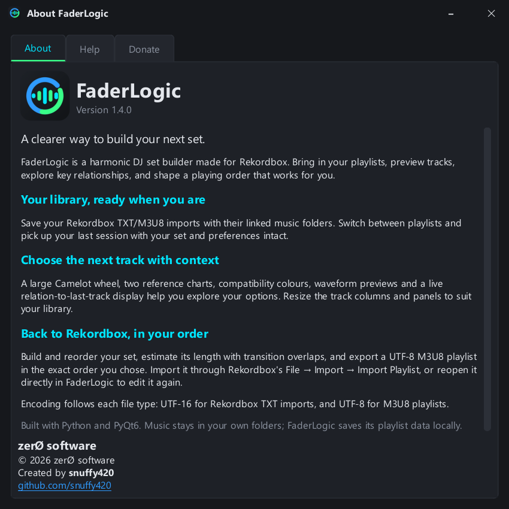</td><td>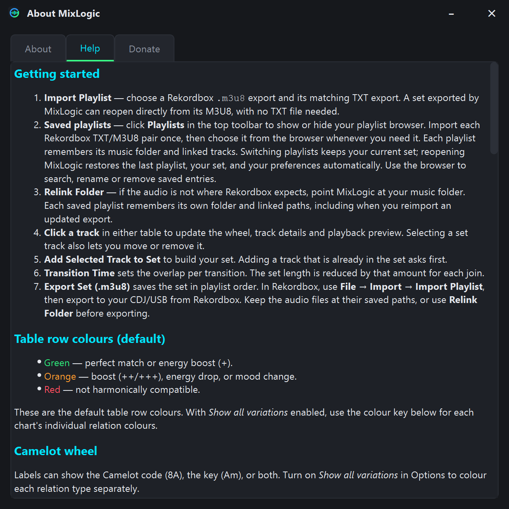</td></tr><tr><td>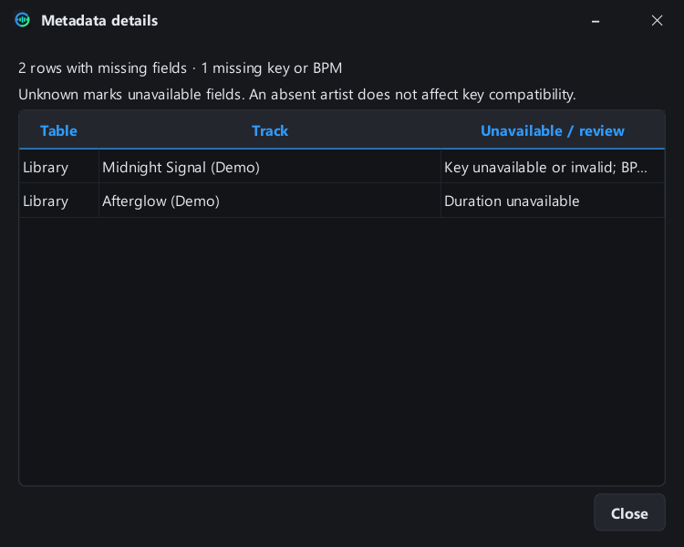</td><td>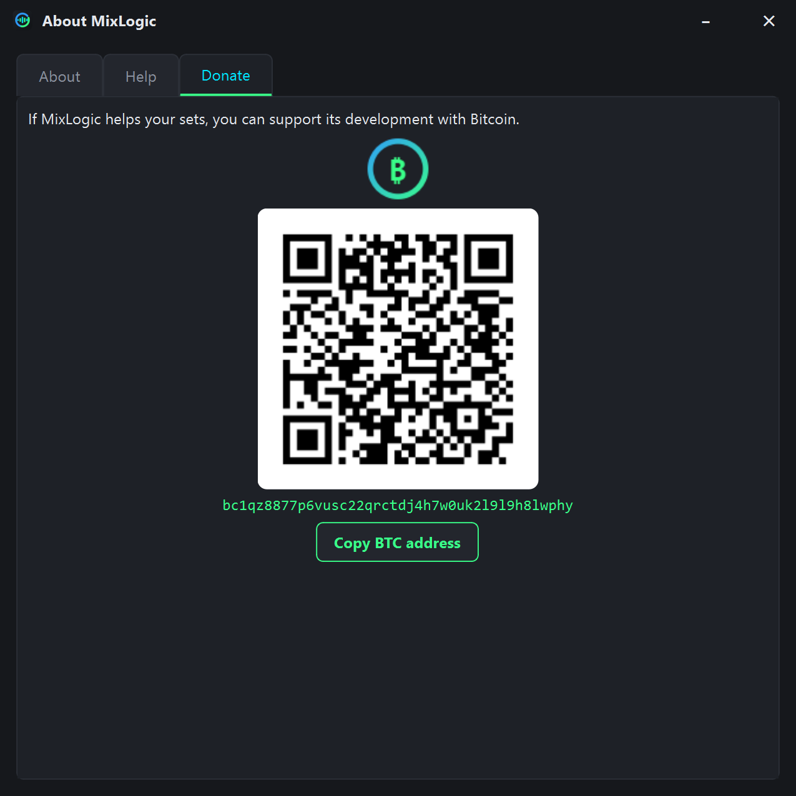</td></tr></table>

## Support and credits

**zerØ software** · © 2026 · Created by [snuffy420](https://github.com/snuffy420).

If MixLogic is useful to you, optional Bitcoin donations support its development:

`bc1qz8877p6vusc22qrctdj4h7w0uk2l9l9h8lwphy`

Use **About → Donate → Copy BTC address**, or scan the in-app QR code. The copy confirmation uses a reserved footer and does not resize the window.

MixLogic is an independent project, not an official Rekordbox or AlphaTheta product. Product names belong to their respective owners.
