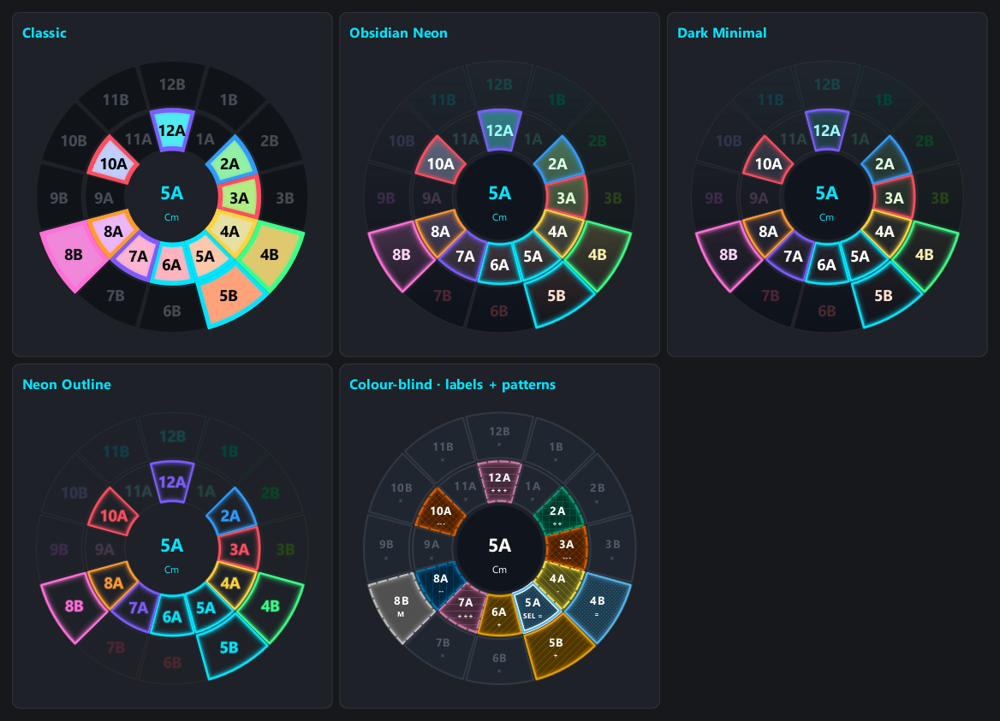
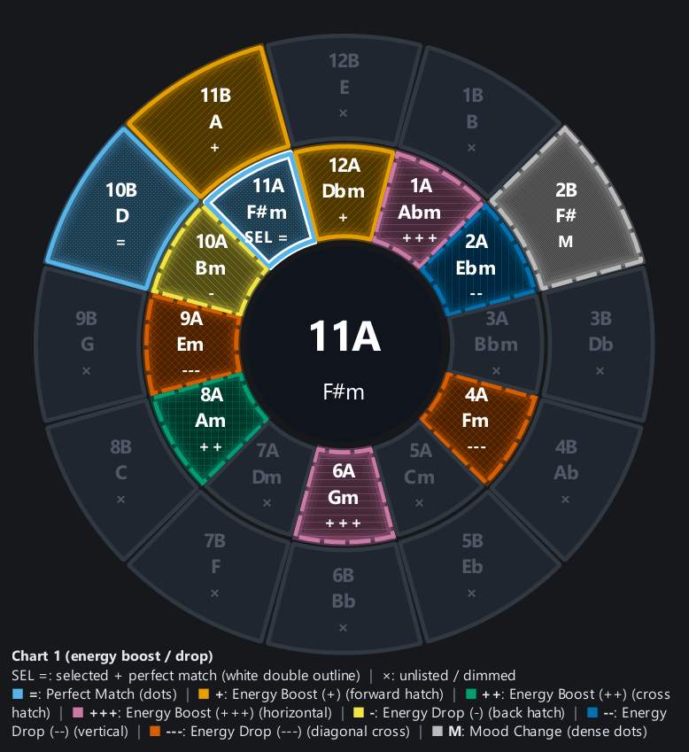
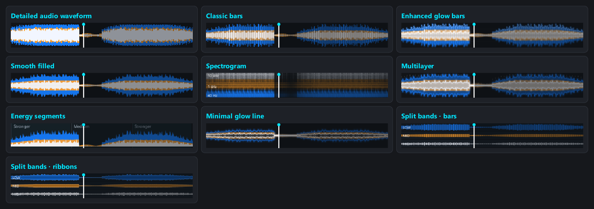
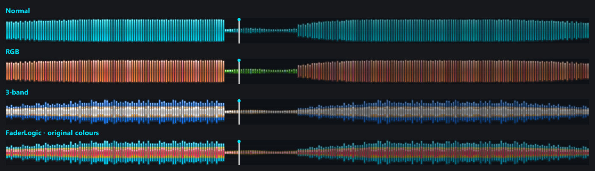
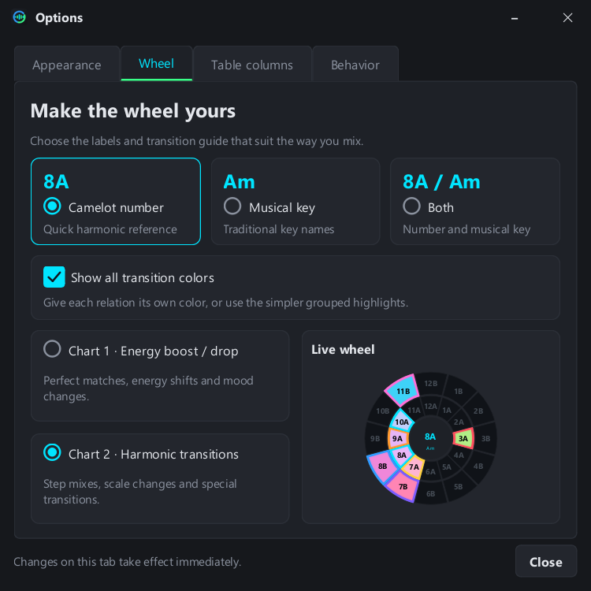
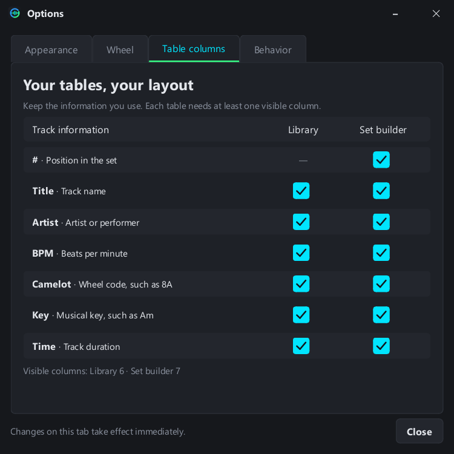
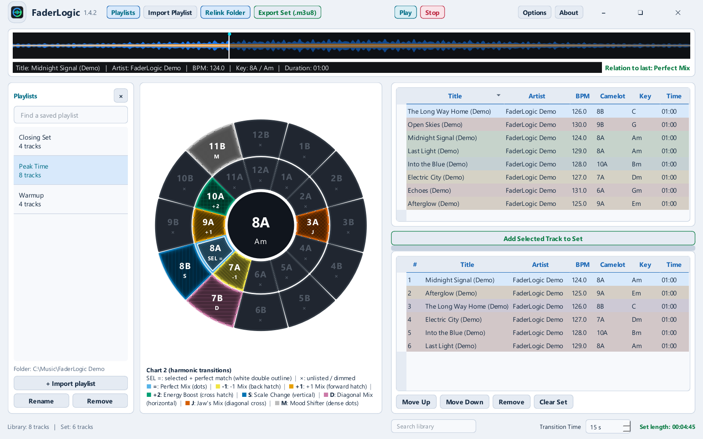
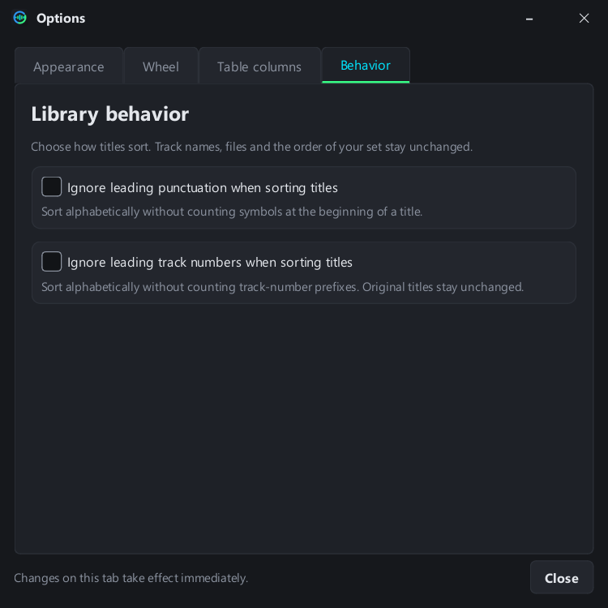
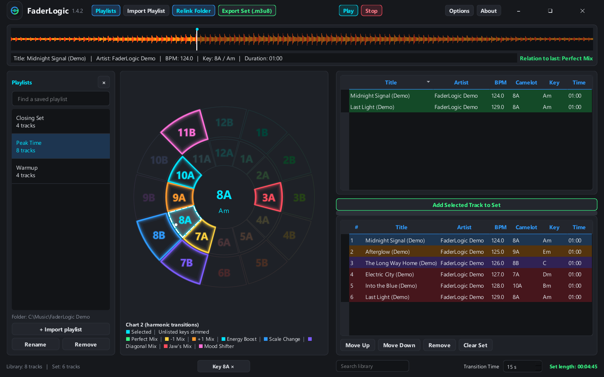

# FaderLogic 1.4.2 appearance guide

[Back to README](../README.md)

## One wheel, five designs

All standard designs share their key colors, relation palette, chart direction, labels and selected-key center display. Per-wedge outline/glow regions keep adjacent colors independent.

| Design | Details |
| --- | --- |
| Classic | Original filled colors and bold relation outlines |
| Obsidian Neon | Dark gradient faces and luminous edges |
| Dark Minimal | Subtle fills and restrained highlights |
| Neon Outline | Transparent interiors, colored glowing labels and borders |
| Colour-blind | Relation-specific alternate colors, patterns, text codes and selection rails |

## Both charts and the accessible wheel

The selected code and musical name appear in the center. With Both labels, the accessible wheel stacks number, musical key and relation code. SEL = adds a white double outline while retaining the blue perfect-match color/dots. × means unlisted, with the sector dimmed.

Chart 1 uses =, +, ++, +++, -, --, ---, M. Chart 2 uses =, -1, +1, +2, S, D, J, M. Their legends come from the actual chart classifications. Grouped mode uses blue/gold relation colors; detailed mode uses eight relation colors. Help explains each chart and pattern separately.

## Ten waveform designs

All are rendered by the actual app widgets below, using the same original audio example.

Detailed audio waveform shows a fine signed envelope measured from decoded PCM samples. Classic bars retains the original look. Enhanced glow bars adds lighting. Smooth filled forms a continuous envelope. Spectrogram shows frequency versus time. Multilayer combines peak and envelope information. Energy segments distinguish measured energy levels, not inferred musical sections. Minimal glow line is a thin envelope. Split bands bars/ribbons provide three explicit lanes.

## Four color modes on every design

Normal is cyan amplitude. RGB mixes measured bass/red, mid/green and high/blue. 3-band uses blue bass, orange mids and white highs on a shared centerline. FaderLogic original colors uses cyan/orange/pink. Frequency boundaries are below 250 Hz, 250–2500 Hz and above 2500 Hz. These are FaderLogic’s own visualizations, not proprietary Pioneer analysis.

The Appearance preview copies the currently loaded track's overview when available. Otherwise it uses a full original dance arrangement analyzed by the same production pipeline. Opening Options does not analyze the example in real time.

## Apply and persistence

Appearance choices remain local to the preview until Apply. The theme/design/mode return on restart. Wheel label/chart/highlight settings and column controls take effect immediately. Standard key/chart colors remain the same in both interface themes.

## Library filters and sorting

Click a highlighted wheel wedge to filter the library to its exact key. A brighter fill, dashed white inset and white dot mark the active filter. Click again, or use the centered key control in the bottom footer to clear it. The control reserves its space while hidden, keeping the workspace stable. Text search combines with the filter.

Options → Behavior provides independent saved switches to ignore leading punctuation and track-number prefixes when sorting titles. These settings leave displayed names, files and set/export order unchanged. Full supported formats are explained in Help.

